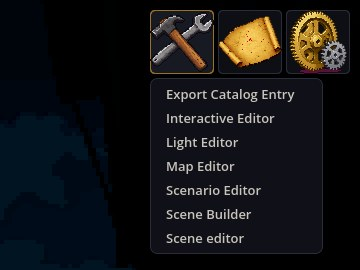
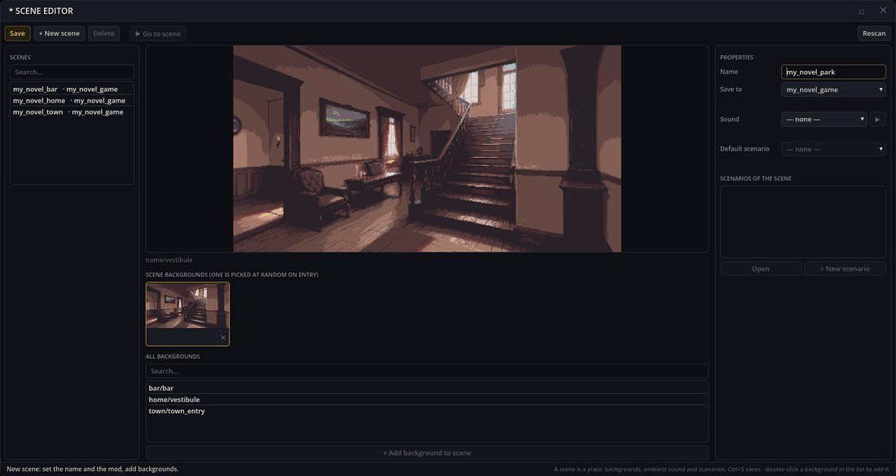
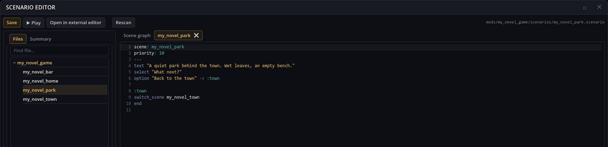
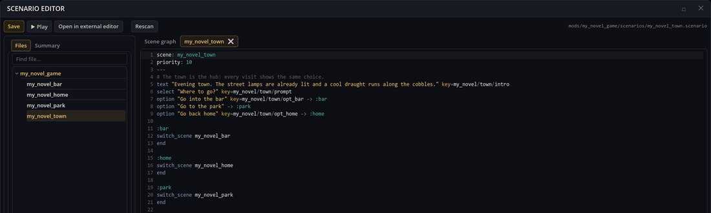
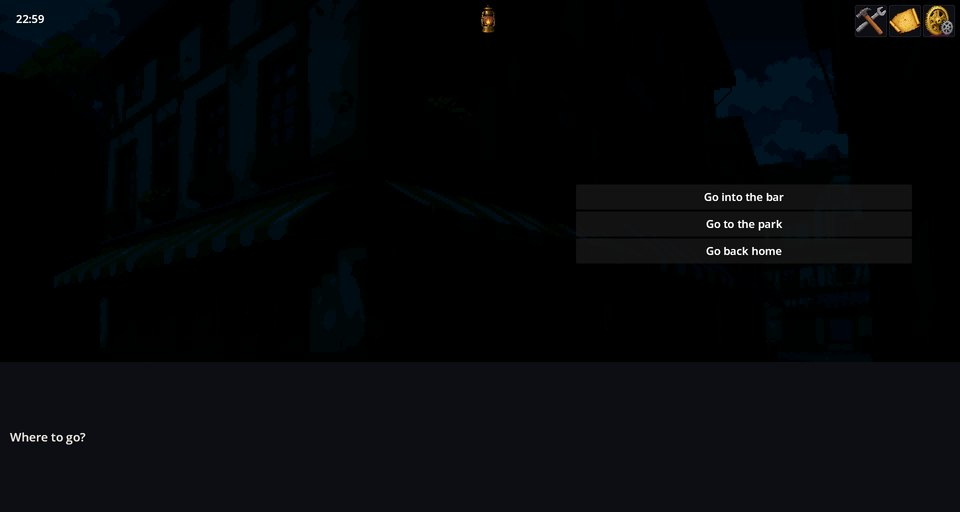
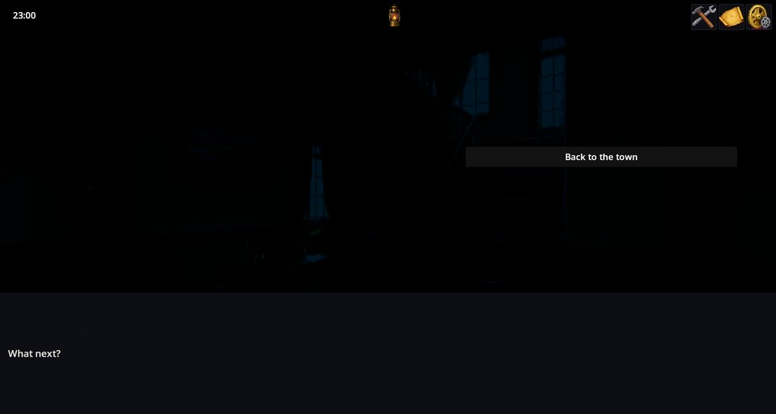

# Editor Tools — 実行中のゲーム内でシーンとシナリオを作る

`editor_tools` はコードを持たない互換パッケージです。`scenario_editor`、`scene_editor`、`scene_builder`、`map_editor`、`interactive_editor`、`light_editor`、`catalog_export` を導入します。共有ライブラリは `tools_base` と `scenario_tools_base` です。

Editor Tools は、実行中のゲームの上に開く作者向けのウィンドウ群です。シーンエディター、シナリオエディター、ワールドマップ・インタラクティブ・ライトの各エディター、Godot シーンのビルダー、MOD カタログの書き出しが含まれます。保存されるのはどれも普通の MOD ファイルで、ゲームは変更をすぐに取り込みます。そのため、場所を書いて、その場に入って遊ぶまでを、再起動なしで行えます。

互換パッケージです。7つのウィンドウは独立したMODになり、共通機能は `tools_base`、シナリオ機能は `scenario_tools_base` にあります。すべてゲーム内ツールバーから開き、メインメニューにはボタンを追加しません。

## ツールを開く

ゲーム内では、ツールバーのハンマーのボタンでツールボックスが開きます:



- 7 つのウィンドウはすべてツールボックスにあります: **シーンエディター**、**シナリオエディター**、**マップエディター**、**インタラクティブエディター**、**ライトエディター**、**シーンビルダー**、**カタログ項目を書き出す**。ほかのツール MOD もそこに独自の項目を追加します（アイテム、キャラクター、RPG マップ、RPG オブジェクトのエディター、データエディター）。
- **シナリオエディター**はシーンエディターからも開けます。シーンを選び、そのシナリオのひとつを選んで**開く**を押すか、**+ 新しいシナリオ**を押します。

ウィンドウはシーンを切り替えても開いたまま残り、移動やサイズ変更ができ、×で閉じます。

## 小さな編集をひと通り: 新しい場所

ノベルのテンプレートには、町、バー、家があります。ここではエディターだけを使って、町から行ける公園を追加します。

**1. 新しいシーン。** シーンエディターで **+ 新しいシーン**を押し、名前を入力し、保存先の MOD を選んで背景を追加します:



保存（Ctrl+S）すると `scenes/my_novel_park.json` が `my_novel_game` に書き込まれ、ゲームはそのシーンをすぐに認識します。

**2. そのシナリオ。** **+ 新しいシナリオ**を押すと、そのシーンのファイルを開いたシナリオエディターが立ち上がります。公園からは戻る道が一本だけあります:



**3. そこへ行く道。** 町のシナリオに、答えをひとつとラベルをひとつ追加します:



```scenario
option "公園へ行く" -> :park

:park
switch_scene my_novel_park
end
```

シナリオを保存するとゲームのシナリオキャッシュが破棄されるので、次に町へ入ったときには新しいテキストが再生されます。

**4. 遊んでみる。** シーンエディターの**シーンへ移動**を押すか、そのまま遊び続けると町に入り、新しい答えがそこにあります:





## 各エディター

- **シーンエディター** — ノベルの場所: 名前、保存先の MOD、背景（入るたびにひとつがランダムで選ばれます）、試聴ボタン付きの環境音、既定のシナリオ、そのシーンのシナリオ。**シーンへ移動**は進行中のダイアログを終わらせてシーンに入ります。
- **シナリオエディター** — すべての MOD のファイル、概要、シーンと遷移のグラフ、DSL のハイライト、Ctrl+S で保存。**プレイ**（F5）は保存して実行中のゲーム内でシナリオを再生し、停止するとゲームが元いた場所へ戻ります。**外部エディターで開く**はシステムのエディターでファイルを開きます。
- **マップエディター** — ワールドマップのゾーン。
- **インタラクティブエディター** — 現在のシーンのクリックできるオブジェクト。
- **ライトエディター** — 現在のシーンのライト。
- **シーンビルダー** — MOD 用の Godot `.tscn` シーン。
- **カタログの書き出し** — MOD を zip にまとめ、チェックサム付きで MOD カタログ用のエントリーを書き出します。

Validator が MOD 間の参照を検査します。通常会話の保存では全検査は行いません。`npc_barks_base` があれば、不正な環境シナリオとそのパッチは保存前に拒否され、コンパイルエラーが状態欄に表示されます。

## どの MOD のファイルが書かれるか

ツールが書き込むのは、フォルダーとしてインストールされた MOD だけです。シーンは全 MOD の `scenes/<name>.json` の合計なので、シーンエディターは**保存先**で選んだ MOD のファイルを書き込みます。他の MOD やパッケージ済みの MOD に属するシーンを変更すると、それを補うファイルがあなたの MOD に作られ、他のファイル由来の背景はロックされて表示されます。シナリオは所属する MOD に保存されます。

## うまくいかないとき

1. **ハンマーのボタンがない。** そのゲームにツールが入っていません。コレクションに Developer Tools ツールセットを追加するか、`--with-mods=editor_tools` で起動してください。
2. **新しいシナリオが再生されない。** ヘッダーが別のシーンを指しているか、そのシーンの別のシナリオが先に選ばれています（`priority` を比べてください）。
3. **保存先に MOD が出ない。** 書き込めるのはフォルダーとしてインストールされた MOD だけです。
