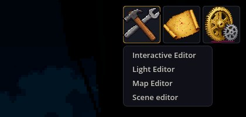
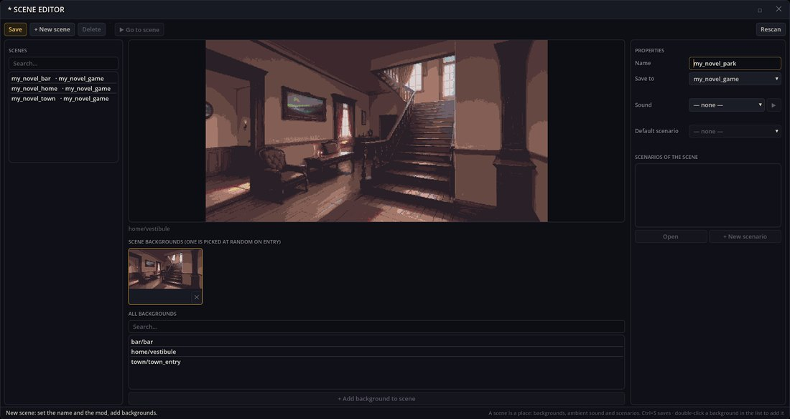
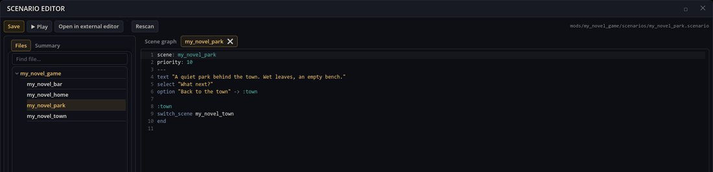
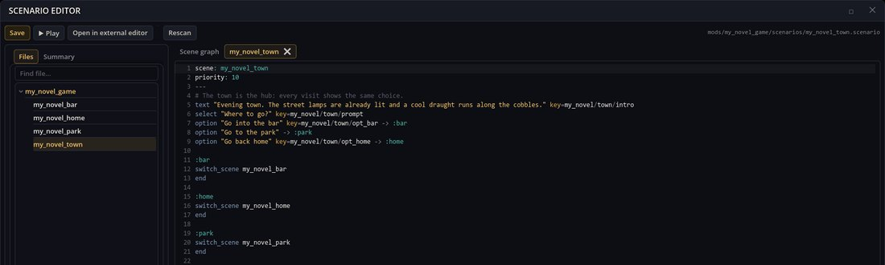
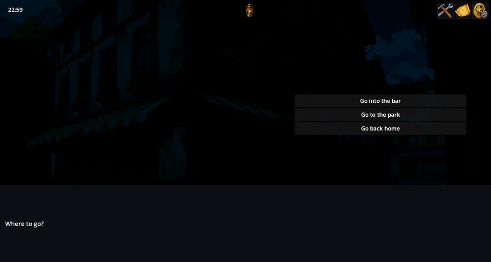
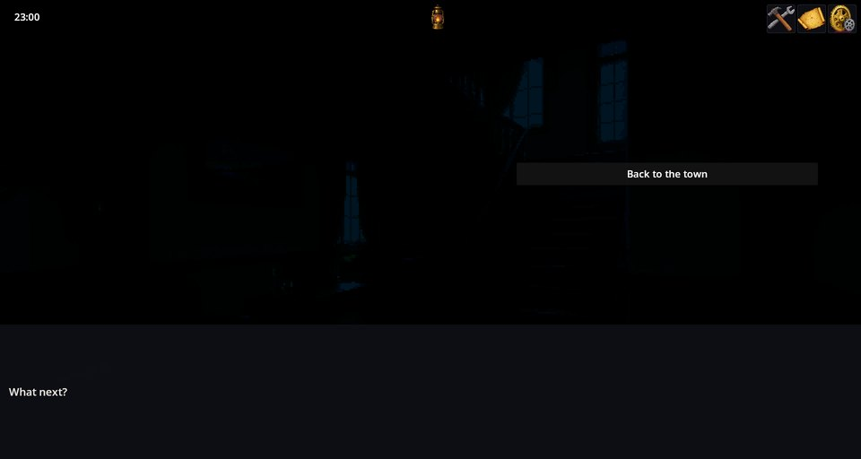

# Editor Tools — 在运行中的游戏里制作场景与剧本

Editor Tools 是叠在运行中游戏之上的作者工具窗口：场景编辑器、剧本编辑器、世界地图编辑器、交互物编辑器和光照编辑器，还有一个 Godot 场景构建器与模组目录导出。它们保存的全是普通的模组文件，游戏会立刻读到改动，所以作者可以写下一个地点，马上走进去试玩，无需重启。

本模组还包含物品与角色编辑器的底层部分（它们是两个独立的模组：Items Editor 和 Characters Editor）。游戏通过 Developer Tools 工具集或自己的集合获得这些工具。

## 打开工具

在游戏中，工具栏上的锤子按钮会打开工具箱：



- 工具箱里有**场景编辑器**、**地图编辑器**、**交互编辑器**和**光照编辑器**。其他工具模组会往里面添加自己的条目（物品、角色和 RPG 地图编辑器，以及数据编辑器）。
- **剧本编辑器**从场景编辑器打开：选中一个场景，挑一个它的剧本，按**打开**，或者按 **+ 新剧本**。
- 如果在主菜单就加载了工具（比如用 `--all-mods`），菜单的工具区里每个工具也都有按钮，包括场景构建器和目录导出。

这些窗口在切换场景后依然开着，可以拖动和调整大小，点叉号关闭。

## 一次完整的小改动：一个新地点

小说模板里有小镇、酒吧和家。下面只用编辑器，给小镇加一个能走过去的公园。

**1. 新场景。** 在场景编辑器里按 **+ 新场景**，输入名称，选择保存到哪个模组，再添加一个背景：



保存（Ctrl+S）会把 `scenes/my_novel_park.json` 写进 `my_novel_game`，游戏马上就知道这个场景了。

**2. 它的剧本。** **+ 新剧本**会打开剧本编辑器，里面是该场景的一个文件。公园只有一条回去的路：



**3. 通往那里的路。** 在小镇的剧本里加一个回答和一个标签：



```scenario
option "去公园" -> :park

:park
switch_scene my_novel_park
end
```

保存剧本会清掉游戏的剧本缓存，所以下次进小镇时播放的就是新文本。

**4. 试玩。** 在场景编辑器里点**前往场景**，或者干脆继续玩下去，就会进入小镇，新的回答已经在那里了：





## 各个编辑器

- **场景编辑器** —— 小说的地点：名称、保存到的模组、背景（进入时随机选一个）、带试听按钮的环境音、默认剧本和场景的剧本。**前往场景**会结束当前对话并进入该场景。
- **剧本编辑器** —— 所有模组的文件、一份概要，以及场景与转场的图；DSL 高亮；Ctrl+S 保存；**试玩**（F5）保存并在运行中的游戏里播放剧本，停止则回到游戏原来的位置；**在外部编辑器中打开**会用系统默认程序打开文件。
- **地图编辑器** —— 世界地图上的区域。
- **交互编辑器** —— 当前场景里可点击的对象。
- **光照编辑器** —— 当前场景的灯光。
- **场景构建器** —— 为模组制作 Godot `.tscn` 场景。
- **目录导出** —— 把模组打包成 zip，并写出带校验和的模组目录条目。

编辑期间可以撤销（文本里和物品、角色编辑器的表单里都支持 Ctrl+Z）。检查模组有没有失效引用是 Validator 的活儿；编辑器不会拦着你保存一个有错误的剧本。

## 写的是谁的文件

这些工具只写安装成文件夹的模组。一个场景是所有模组 `scenes/<name>.json` 文件的总和，所以场景编辑器写的是**保存到**里选中的那个模组的文件。改动属于别的模组或打包模组的场景时，会在你的模组里新建一个文件来补充它；来自其他文件的背景会显示为锁定。剧本则保存在它所属的模组里。

## 出问题了怎么办

1. **找不到锤子按钮。** 这个游戏没带工具；在它的集合里加上 Developer Tools 工具集，或者用 `--with-mods=editor_tools` 启动。
2. **新剧本不播放。** 它的头部写的是另一个场景，或者这个场景里有别的剧本先被选中了（比较它们的 `priority`）。
3. **「保存到」里没有模组。** 只有安装成文件夹的模组才能写入。
